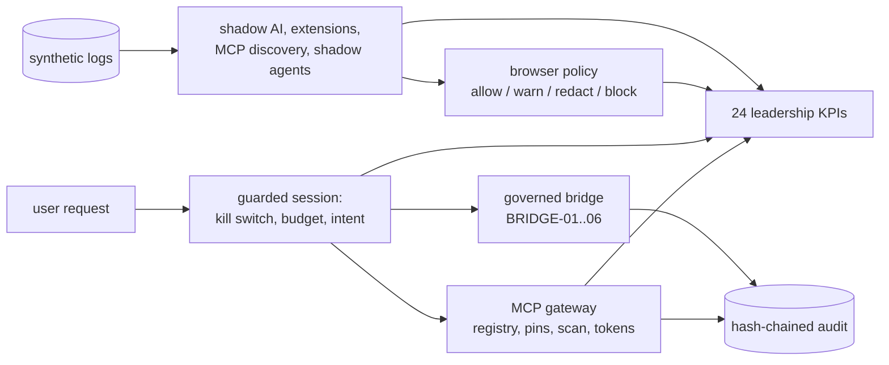

# Agentic Security Layer

**Recruiter summary.** AI agents and AI tools spread faster than governance. This repo is the
cross-cutting control plane for both. It discovers shadow AI apps, browser extensions, coding assistants,
MCP servers and unregistered agents from synthetic logs; decides allow, warn, redact or block per browser
event; forces every agent tool call through a kill switch, budget and loop limits, an intent check against
the user's request, and a governed bridge with human approvals the agent cannot forge; secures MCP with
allow lists, pinned tool descriptions, a hidden-instruction scan and short-lived audience-bound tokens; and
writes a 24-KPI leadership report. Deterministic and offline; every output and the test count below are
rendered from a real run and checked in CI.

**Start here:** [docs/00_START_HERE.md](docs/00_START_HERE.md) (numbered reading path, steps 00-17).

## Architecture



## What it does

1. **Agent registry** — every AI agent registered with granted tools, data
   scopes, autonomy level (L0-L3), and owner.
2. **Shadow-AI detection** — callers in activity logs but not in the
   registry are scored by privilege exercised and get an onboard-or-block
   recommendation (SHADOW-01/02). Suspended or revoked agents that still
   act are flagged for blocking (SHADOW-03). Findings are persisted and
   readable through `v_shadow_findings`.
3. **Privilege graph** — agents -> tools -> data scopes. `blast_radius`
   returns everything a compromised agent can reach; `escalation_paths`
   finds paths to high-sensitivity nodes.
4. **Effective privilege** — direct-grant review misses indirect paths.
   `effective_privilege` resolves nested group membership (EFF-01),
   wildcard grants (EFF-02), and dormant grants (EFF-03) into the full
   tool/scope set with every path cited. `hidden_escalations` finds
   privileges reachable ONLY indirectly. Demo: `agt-router` looks like a
   read-only L1 agent on direct review but effectively holds
   `rotate_secret` (sensitivity 5) via a dormant break-glass grant.
   Compromise analysis over effective privilege revokes indirect-only
   access first, since it survives naive cleanup.
5. **Compromised-agent impact** — exposure ranked by sensitivity with
   prioritized containment actions (suspend, revoke, rotate, review).
6. **Governed tool bridge (centerpiece)** — agents never call tools
   directly; the bridge verifies registration (BRIDGE-01), grant
   (BRIDGE-02), autonomy level (BRIDGE-03), and human approval for
   destructive actions (BRIDGE-04, fail-closed). The agent cannot assert
   approval itself: a named human issues it through `Bridge.approve`, and
   it is single-use, scoped to one agent and tool, and expires
   (BRIDGE-05). Approvers must be people, not agents (BRIDGE-06). JIT
   elevation unlocks writes for L1 agents, needs a named approver, and
   expires (at most 8h). A tool missing from the catalog is treated as
   destructive. Denials are persisted to `v_bridge_denials`.
7. **Zero-standing-privilege posture** — environment score 0-100 with a
   prioritized improvement list.
8. **Shadow AI and SaaS inventory** (new) — AI apps, SaaS, extensions,
   coding assistants and MCP tools from synthetic proxy, browser, IDE and
   network logs, with sanction states approved / monitored / unsanctioned
   plus personal-account and unclassified use (SAI-01..04).
   [Step 05](docs/05_SHADOW_AI_AND_BROWSER.md)
9. **Browser AI usage policy, extension risk, coding-agent prompt guard**
   (new) — allow / warn / redact / block per event (BPOL-01..05), extension
   permission scoring (EXT-01..04), secrets and restricted code stopped
   before a coding assistant sends them (CSG-01..05).
10. **Runtime guardrails v2** (new) — intent-bound actions (INTENT-01..04),
    step / token / cost caps and loop detection (BUDGET, LOOP), a
    fail-closed kill switch (KILL-01/02), and a risk card per agent
    (RISK-01..06). [Step 06](docs/06_RUNTIME_GUARDRAILS_V2.md)
11. **MCP security module** (new) — server allow / deny lists and grants
    (MCP-01..05), description and schema pinning with quarantine on drift
    (DRIFT-01..04), hidden-instruction scan (POISON-01..07), tool-name
    shadowing, audience- and scope-bound tokens with TTL at most 900 s
    (TOK-01..06), and discovery from network logs.
    [Step 07](docs/07_MCP_SECURITY.md)
12. **Leadership KPIs** (new) — 24 KPIs, daily and weekly, as Markdown, CSV
    and an HTML preview in `reports/`; each row says whether it was measured
    here or is a labelled synthetic sample. [Step 08](docs/08_LEADERSHIP_REPORT.md)

## Real run output (rendered from a fresh run in CI)

Demo scenario (`agelayer/demo_helpers.py::run_scenario`, fixed clock):

<!-- run: python scripts/show_differentiator.py -->
```text
shadow ghost-helper   SHADOW-01 -> onboard (score 1)
shadow rogue-cleaner  SHADOW-01 -> block (score 9)
bridge agt-router    read_tickets    allowed
bridge agt-router    write_invoice   denied  BRIDGE-02
bridge rogue-cleaner purge_cache     denied  BRIDGE-01
bridge agt-jit-demo  write_invoice   denied  BRIDGE-03
bridge agt-jit-demo  write_invoice   allowed
bridge agt-biller    write_invoice   allowed
bridge agt-deployer  deploy_service  allowed
bridge agt-cache     purge_cache     denied  BRIDGE-04
bridge agt-cache     purge_cache     allowed  by r.osei (security on-call)
bridge agt-cache     purge_cache     denied  BRIDGE-05
denials in v_bridge_denials: 5, shadow callers in v_shadow_findings: 2
blast radius of agt-deployer: 6 nodes, 4 escalation paths, 6 exposed on compromise
zsp improvements: [(1, 'standing write access'), (2, 'shadow agents'), (3, 'JIT adoption'), (4, 'credential rotation')]
zsp score: 44.0; audit entries 15, chain valid: True
```
<!-- /run -->

The three `agt-cache` lines are the approval flow: the agent's own claim of
approval is denied, a human-issued approval is accepted once, and replaying
it is denied.

## How this differs from machine-identity-security

The sibling `Jagadish-machine-identity-security` repo governs the
**identities** themselves: lifecycle scoring, vaulting, compromise signals,
revocation. This repo governs what AI agents **do** with identities:
discovery of unregistered agents, blast-radius analysis, per-action
governance through the bridge, and posture measurement. Identities vs
actions — the two halves of non-human identity security.

## How this differs from agent-identity-security and agent-auth-security

Checked against the code of each repo, not only its README:

- **vs `agent-identity-security`**: that repo is a posture *scanner* over
  an exported cloud identity inventory: detection rules (over-privileged
  agents, standing admin roles, unowned identities) plus privilege-path
  and blast-radius analysis to crown-jewel resources. **Overlap, stated
  honestly:** its blast-radius path analysis and this repo's privilege
  graph (`graph.py`, `impact.py`) answer the same question, and its
  standing-privilege rules resemble the ZSP scorer. What its code does not
  have, and this repo does: a runtime bridge that every action passes
  through, human approvals the agent cannot forge, expiring JIT elevation,
  and shadow-agent detection from activity logs. Assessment vs
  enforcement.
- **vs `agent-auth-security`**: that repo implements *authentication
  mechanisms* (JWT, sessions, DPoP, OAuth flows, delegation, refresh-token
  reuse detection) — how agents prove who they are. No code overlap. This
  repo assumes authenticated agents and governs what they're *allowed to
  do*. AuthN vs runtime authZ.

## Guardrails, each proven by a test

| Claim (all tests in `tests/test_agelayer.py` unless noted) | Test |
|---|---|
| Unregistered, suspended and revoked agents are denied at the bridge | `test_bridge_denies_unregistered_agent`, `test_bridge_denies_suspended_agent`, `test_revoked_agent_denied_and_its_activity_flagged` |
| Ungranted tools and L0 execution are denied | `test_bridge_denies_ungranted_tool`, `test_bridge_denies_l0_execution` |
| Destructive actions need L2 plus a human approval (fail-closed) | `test_bridge_destructive_needs_human_approval`, `test_destructive_still_needs_l2_even_with_approval` |
| The agent cannot approve its own action | `test_agent_cannot_approve_its_own_destructive_action` |
| Approvals are single-use, scoped and expire | `test_approval_is_single_use_scoped_and_expires` |
| JIT elevation is scoped and expires | `test_bridge_elevation_wrong_tool_denied`, `test_jit_elevation_expires` |
| Tools missing from the catalog are treated as destructive | `test_tool_missing_from_catalog_is_treated_as_destructive` |
| Shadow agents are detected and get onboard/block | `test_shadow_detects_unknown_caller`, `test_shadow_block_for_destructive` |
| Every bridge decision is hash-chained; tampering is detected | `test_every_bridge_decision_is_hash_chained`, `test_audit_tamper_detected` |
| Denials and shadow callers are readable through the views | `test_denials_and_shadow_callers_reach_the_read_views` |
| Indirect privilege resolves through nested groups, wildcards and dormant grants (EFF-01/02/03) | `tests/test_effective.py` (`test_nested_group_two_levels_resolves`, `test_wildcard_grant_expands_to_all_tools`, `test_dormant_grant_included_in_effective`) |
| Hidden escalations (indirect-only privilege) are found and rule-cited; direct-grant review would miss them | `tests/test_effective.py` (`test_hidden_escalations_finds_indirect_only_privilege`, `test_direct_grant_review_misses_hidden_escalation`) |
| Compromise analysis over effective privilege revokes indirect-only access first | `tests/test_effective.py` (`test_impact_effective_prioritizes_hidden_revocation`) |
| Gateway denies base tables, schema, writes and `load_extension` with the text check off | `tests/test_authorizer_strict.py` |
| PII scrubbed from free-text feedback; ISO dates kept | `test_feedback_scrubs_ssn_and_email`, `test_feedback_keeps_dates` |
| Tool calls outside the user's request are denied; empty scope fails closed (INTENT-01..04) | `tests/test_intent.py`, `tests/test_guarded.py` |
| Step, token, cost caps, loops and the kill switch stop sessions; unreadable switch denies | `tests/test_budget.py` |
| Only named humans widen scopes, reset stops, pin MCP listings, approve policy changes or sign off blocks | `test_widen_needs_human`, `test_kill_reset_needs_human`, `test_pin_needs_human`, `test_policy_change_needs_other_human`, `test_sign_off_needs_human` |
| MCP drift quarantines until re-approval; poisoned descriptions found; tokens cannot be passed through | `tests/test_mcp.py` |
| Coding-assistant secrets, `.env` reads and restricted code are blocked; values never logged | `tests/test_coding_sessions.py` |
| KPI rows are labelled measured or sample; committed reports match a fresh run | `tests/test_leadership.py` |

Full rule-to-test map: [docs/12_GUARDRAILS.md](docs/12_GUARDRAILS.md).

Residual: a column-free `count(*)` on a table behind a view can return a
row count (no values); the text check blocks the plain form.

## Limitations

- The tool backend, vault, and JIT store are **simulations** — no real
  privileged operations are performed.
- Shadow detection needs activity logs; it cannot see agents that never
  act.
- The privilege graph is only as complete as the registered grants.
- The intent parser and the MCP poisoning scan are pattern-based; known
  misses (synonyms, paraphrase, non-English) are kept as tests.
  Measured: intent 30 cases, precision 0.941, recall 0.941; poisoning 24
  cases, precision 1.0, recall 0.833 (synthetic, self-written sets).
- All logs, apps, prices and approvals in the new modules are synthetic.
- Out of scope: real secret storage, session recording, endpoint
  controls, device posture. Full list: [docs/13_LIMITATIONS.md](docs/13_LIMITATIONS.md).

## How to run

```bash
python3 -m pytest tests/ -q
python3 scripts/count_tests.py     # prints the real total
```

<!-- run: python scripts/count_tests.py -->
```text
326 tests collected
```
<!-- /run -->

## Standardization review (2026-10-18)

Bugs found in review and fixed, each with a regression test (section
"review fixes" in `tests/test_agelayer.py`):

| ID | Bug | Fix |
|---|---|---|
| BRIDGE-05 | An agent could set `human_approved=True` on its own request and run a destructive tool | The flag is ignored; only a human-issued, single-use, scoped, expiring approval counts |
| BRIDGE-06 | Approvals and elevations had no approver; an agent could approve itself | A named approver who is not a registered agent |
| BRIDGE-JIT-01 | JIT elevation never expired and could be unbounded | Expiry is checked on every call; cap 8h |
| BRIDGE-CAT-01 | A tool missing from the catalog was treated as a plain write | Treated as destructive (fail-closed), here and in graph, impact and shadow scoring |
| AUDIT-BRIDGE-01 | Bridge decisions went to a plain list, not the hash chain | Every decision is chained |
| VIEW-EMPTY-01 | `v_bridge_denials` and `v_shadow_findings` read tables nothing wrote to | Denials and shadow findings are persisted |
| SHADOW-03 | Suspended or revoked agents still acting were not flagged | Flagged for block |
| VIEW-COUNT-01 | `tool_count` counted an empty grant list as 1 | Exact `json_array_length` |
| ZSP-INPUT-01 | Negative or inconsistent inputs produced scores outside 0-100 | Validated; unknown tools count as standing write |
| AUDIT-COPY-01 | The audit kept a live reference to the caller's payload | Stores a copy |

The ZSP demo score moved from 45.5 to 44.0 because the unknown-tool rule
now counts as standing write access. The README also named a cloud
vendor's products in the boundary section; it is now vendor-neutral.

## Docs

Read in order, starting at [docs/00_START_HERE.md](docs/00_START_HERE.md):
purpose, concepts, architecture, registry and bridge, shadow AI and
browser, guardrails v2, MCP, leadership report, how to run,
[use cases](docs/USE_CASES.md), evaluation, guardrails, limitations,
[threat model (STRIDE, OWASP LLM and Agentic)](docs/14_THREAT_MODEL.md),
implementation guide (incl. an Azure deployment mapping), interview points and
the [presentation guide](docs/PRESENTATION_GUIDE.md). ADRs: [docs/adr/](docs/adr/).
Background: [knowledge/domain-notes.md](knowledge/domain-notes.md) ·
[knowledge/architecture.md](knowledge/architecture.md).

## Related repos

- `Jagadish-pii-guard` — prompt DLP gateway: the content checks behind the
  browser policy's `sensitive` flag; owns K03, K04, K19-K21.
- `Jagadish-agent-security-redteam` — OWASP-mapped attacks, MCP attacks and
  release replay; owns K10, K11 and feeds red-team ASR into risk cards.
- `Jagadish-machine-identity-security` — the identities agents use.

## Built / Written-not-run / Planned

| Item | Status |
|---|---|
| Registry, shadow detection, privilege graph, impact analysis | Built |
| Governed bridge with human-issued approvals and expiring JIT elevation | Built |
| Effective-privilege layer (nested groups, wildcards, dormant grants, hidden escalations) | Built |
| ZSP posture scorer | Built |
| Strict authorizer + bypassed-text-check regressions | Built |
| Streamlit demo | Written, not run here (needs streamlit) |
| Shadow AI and SaaS inventory, browser policy, extension scoring, coding-agent guard | Built (synthetic data) |
| Guardrails v2: intent scope, budgets, loop detection, kill switch, risk cards | Built |
| MCP module: registry, pinning, poisoning scan, shadowing, scoped tokens, discovery, gateway | Built (no real MCP server contacted) |
| Leadership KPI report (24 KPIs, daily and weekly, MD / CSV / HTML) | Built; 15 KPIs measured here, 9 labelled samples |
| Intent classifier on top of the keyword parser | Planned |
| Live telemetry connectors (proxy, browser, IDE) | Planned |
| Real vault / IdP integration | Planned (out of scope for synthetic demo) |

## Disclaimer

All data is synthetic and fictional. This is an independent demo project,
not affiliated with any company or vendor. Nothing here connects to real identity
providers or production systems.
