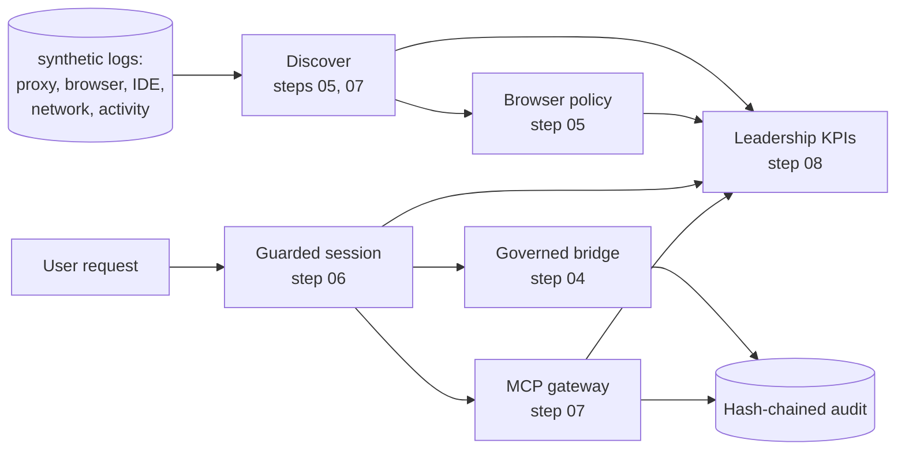

# Start here

*Step 00 of the reading path.*

## What you'll learn

- What this project is, in one minute
- The order to read the docs in, and what each step teaches
- The commands that show the whole thing working

## The project in one minute

People and AI agents both use AI tools at work. People open chat apps, install AI browser extensions and run
coding assistants. Agents call tools, and more and more of those tools sit behind MCP (Model Context
Protocol) servers. Security teams need to answer four questions: *what AI is in use, what is it allowed to
do, is it doing only what it was asked, and how do we report that to leadership?*

`agelayer` answers them with offline, deterministic code on synthetic data:

1. **Discover** AI apps, SaaS, extensions, coding assistants and MCP servers from synthetic logs, including
   unregistered ("shadow") agents.
2. **Decide** per browser event (allow, warn, redact, block) by sanction state, account type and group.
3. **Govern** every agent tool call: a kill switch, budgets and loop limits, an intent check against the
   user's request, then the governed bridge (registration, grant, autonomy, human approval).
4. **Secure MCP**: allow and deny lists, pinned tool descriptions with drift alerts, a scan for hidden
   instructions, and short-lived audience-bound tokens.
5. **Report** 24 leadership KPIs daily and weekly as Markdown, CSV and an HTML preview.



## Reading path

Read in this order. Each doc starts with "What you'll learn" and ends with "Next".

| Step | Doc | You will be able to... |
|---|---|---|
| 00 | this page | explain the project in one minute |
| 01 | [01_PURPOSE.md](01_PURPOSE.md) | explain the problem and who it is for |
| 02 | [02_CONCEPTS.md](02_CONCEPTS.md) | use the vocabulary: sanction state, shadow AI, intent scope, MCP, drift, ASR |
| 03 | [03_ARCHITECTURE.md](03_ARCHITECTURE.md) | draw the components and the order of checks |
| 04 | [04_REGISTRY_AND_BRIDGE.md](04_REGISTRY_AND_BRIDGE.md) | explain the registry, privilege graph and governed bridge |
| 05 | [05_SHADOW_AI_AND_BROWSER.md](05_SHADOW_AI_AND_BROWSER.md) | walk through shadow AI discovery, browser policy, extensions, coding-agent guard |
| 06 | [06_RUNTIME_GUARDRAILS_V2.md](06_RUNTIME_GUARDRAILS_V2.md) | explain intent-bound actions, budgets, kill switch and risk cards |
| 07 | [07_MCP_SECURITY.md](07_MCP_SECURITY.md) | explain MCP allow lists, drift, poisoning, shadowing and scoped tokens |
| 08 | [08_LEADERSHIP_REPORT.md](08_LEADERSHIP_REPORT.md) | read the 24 KPIs and say which are measured |
| 09 | [09_HOW_TO_RUN.md](09_HOW_TO_RUN.md) | run every script and the tests |
| 10 | [USE_CASES.md](USE_CASES.md) | demo seven scenarios end to end |
| 11 | [11_EVALUATION.md](11_EVALUATION.md) | quote the measured precision and recall honestly |
| 12 | [12_GUARDRAILS.md](12_GUARDRAILS.md) | name each safety rule and the test behind it |
| 13 | [13_LIMITATIONS.md](13_LIMITATIONS.md) | say what it misses, before anyone asks |
| 14 | [14_THREAT_MODEL.md](14_THREAT_MODEL.md) | discuss STRIDE, OWASP LLM Top 10 and OWASP Agentic Top 10 |
| 15 | [15_IMPLEMENTATION_GUIDE.md](15_IMPLEMENTATION_GUIDE.md) | plan a rollout, including an Azure deployment mapping |
| 16 | [16_INTERVIEW_POINTS.md](16_INTERVIEW_POINTS.md) | answer interview questions with evidence |
| 17 | [PRESENTATION_GUIDE.md](PRESENTATION_GUIDE.md) | present it in 5 or 15 minutes |

Design decisions are in [adr/](adr/).

## Three commands

```bash
python -m pytest -q                       # all tests, offline
python scripts/show_guardrails_v2.py      # intent, budget, kill switch, risk cards
python scripts/leadership_report.py       # writes reports/leadership_{daily,weekly}.{md,csv,html}
```

## Next

[01_PURPOSE.md](01_PURPOSE.md)
