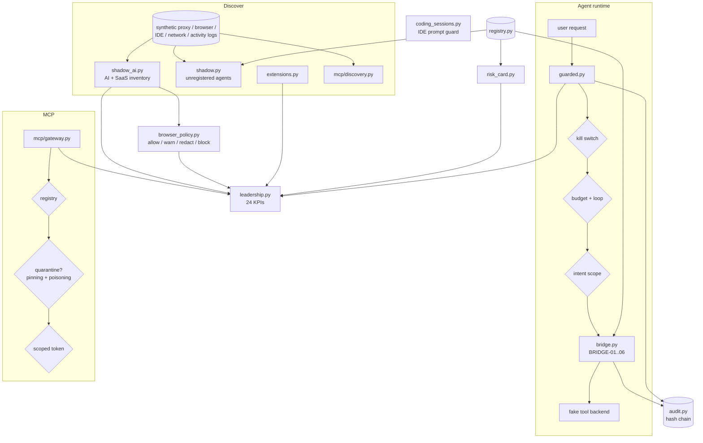

# Architecture

*Step 03 of the reading path.*

## What you'll learn

- The modules and what each owns
- The order of checks on an agent tool call

## Order of checks on a tool call

1. Kill switch (KILL-01, KILL-02 fail-closed)
2. Loop and step budget (LOOP-01/02, BUDGET-01)
3. Intent scope (INTENT-01..04)
4. Governed bridge (BRIDGE-01..06)
5. Token and cost budget after the call (BUDGET-02/03 stop the next call)

The first failure wins. Every decision is written to the hash-chained audit log.

## Module map

| Module | Owns |
|---|---|
| `registry.py`, `bridge.py`, `graph.py`, `effective.py`, `impact.py`, `zsp.py`, `views.py`, `authz.py`, `audit.py` | the original core (step 04) |
| `shadow_ai.py` | AI and SaaS inventory, SAI-01..04 |
| `browser_policy.py` | per-event decision, BPOL-01..05 |
| `extensions.py` | extension risk, EXT-01..04 |
| `coding_sessions.py`, `secrets_scan.py` | coding-agent prompt guard, CSG-01..05 |
| `intent.py`, `budget.py`, `guarded.py` | runtime guardrails v2 |
| `risk_card.py` | per-agent risk card, RISK-01..06 |
| `mcp/` | registry, pinning, poisoning, shadowing, tokens, discovery, gateway |
| `leadership.py`, `scenarios.py` | KPI catalog, report writers, deterministic scenarios |

## Next

[04_REGISTRY_AND_BRIDGE.md](04_REGISTRY_AND_BRIDGE.md)
