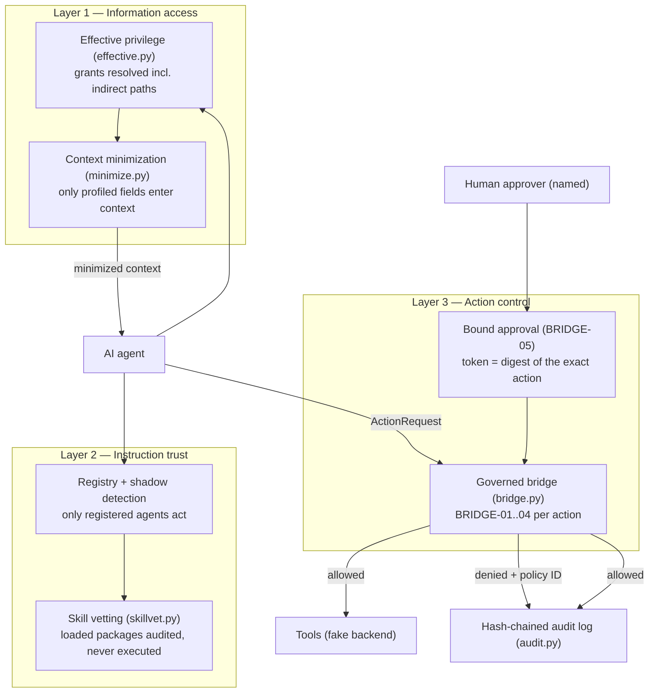

# AI security: the three layers, mapped to this repo

A production AI agent is secured in three layers:

1. **Information access** — what information the agent may reach, and
   how much of it may enter its context.
2. **Instruction trust** — which instructions (and instruction-bearing
   packages) the agent may trust and act on.
3. **Action control** — what the agent may do, through which tools,
   under whose approval.

Every module in this repo exists to enforce one of these layers in
deterministic code, outside the model. The model never makes a security
decision; it proposes, the layer disposes.

## Layer 1 — Information access

| Control | Module | Policy |
|---|---|---|
| Agent inventory with granted tools and data scopes | `registry.py` | statuses, autonomy L0–L3 |
| Effective privilege (indirect, wildcard, dormant grants resolved) | `effective.py` | EFF-01/02/03 |
| Blast radius of a compromised agent | `graph.py`, `impact.py` | sensitivity-ranked containment |
| **Context minimization** — per-task field profiles; only listed fields enter the context, deny-by-default, nested dot paths | `minimize.py` | MIN-01/02 |
| PII scrubbed from free-text feedback before storage | `feedback.py` | phones, SSNs, emails redacted |
| Read gateway: SELECT-only, two independent layers | `views.py` | text check + strict SQLite authorizer |

Context minimization is the least-data half of this layer: least
privilege decides which records an agent may read; minimization decides
how much of a permitted record the model actually sees. Its report
names dropped fields only — values would leak what it protects.

## Layer 2 — Instruction trust

| Control | Module | Policy |
|---|---|---|
| Only registered identities may act at all; unregistered callers are shadow findings | `registry.py`, `shadow.py` | SHADOW-01/02, BRIDGE-01 |
| **Skill vetting** — static audit of the instruction/code packages an agent loads, before they are trusted | `skillvet.py` | SKILL-01..06 |
| Tamper-evident record of every decision | `audit.py` | hash-chained log |

Skills are reusable instructions — often with code — that extend what
an agent does, so an unvetted skill is an untrusted instruction source
with a supply chain attached. The vetter compares what a package's code
actually does (shell, network, sensitive paths, obfuscation) against
what its manifest declares; undeclared capability is a BLOCK.

Boundary, stated plainly: content-level prompt-injection resistance
inside the agents themselves (sanitizing retrieved text, delimiting
untrusted content) is **out of scope for this repo** — see the README
limitations. This layer here covers *whose* instructions may run
(registered agents, vetted skills), not the sanitizing of content an
agent reads.

## Layer 3 — Action control

| Control | Module | Policy |
|---|---|---|
| Governed tool bridge — every tool call checked per action | `bridge.py` | BRIDGE-01..05 |
| Tool must be in the agent's grant | `bridge.py` | BRIDGE-02 |
| Autonomy level sufficient for the tool category | `bridge.py` | BRIDGE-03 |
| JIT elevation for writes, with expiry | `bridge.py` | BRIDGE-03 |
| Destructive actions need human approval, fail-closed | `bridge.py` | BRIDGE-04 |
| **Bound approval** — approval is a single-use token bound to the SHA-256 digest of the exact (agent, tool, args); named approver, expiring | `bridge.py` (`ApprovalBook`) | BRIDGE-05 |
| Zero-standing-privilege posture score | `zsp.py` | 0–100 + improvements |

Approval is not authorization, and a bare "approved" flag is not bound
to anything: BRIDGE-05 exists because an approval given for one action
(a refund to one recipient, for one amount) must not survive a change
to that action. Any post-approval edit changes the digest and is
denied; the token is consumed on first use, so it cannot be replayed.

## How the layers compose

Read top to bottom: an agent must be a *known* identity loading only
*vetted* instructions (Layer 2) before it can touch information; it
sees only the *minimized* slice of the information its grants allow
(Layer 1); and every action it attempts passes the bridge, with
destructive actions bound to a named human's approval of that exact
action (Layer 3). Each denial carries a policy ID and lands in the
audit log, so every control in this map is provable from the test
suite, not just described.
