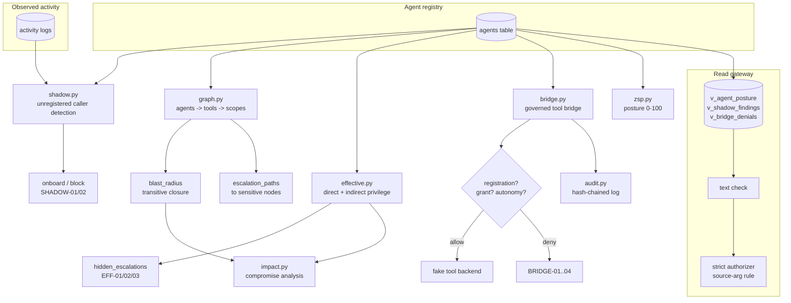

# Architecture

## Module responsibilities

| Module | Owns |
|---|---|
| `registry.py` | Agent inventory, autonomy levels L0-L3, status |
| `shadow.py` | Unregistered-caller detection + onboard/block scoring |
| `graph.py` | Privilege graph, blast radius, escalation paths |
| `effective.py` | Effective privilege: nested groups (EFF-01), wildcards (EFF-02), dormant grants (EFF-03); `hidden_escalations` finds indirect-only privilege |
| `impact.py` | Compromise exposure ranking + containment actions |
| `bridge.py` | Per-action governance (centerpiece) |
| `zsp.py` | Zero-standing-privilege posture score |
| `views.py` | Read-only views + SELECT-only gateway |
| `authz.py` | SQLite authorizer backstop (strict, view-aware) |
| `audit.py` | Hash-chained decision log |
| `feedback.py` | PII scrubbing before storage |
| `shadow_ai.py`, `browser_policy.py`, `extensions.py`, `coding_sessions.py` | workforce AI discovery and browser-level controls (docs step 05) |
| `intent.py`, `budget.py`, `guarded.py`, `risk_card.py` | runtime guardrails v2 (docs step 06) |
| `mcp/` | MCP registry, pinning, poisoning, shadowing, tokens, discovery, gateway (docs step 07) |
| `leadership.py`, `scenarios.py` | KPI catalog and report writers (docs step 08) |

The full reading path, with the v2 architecture diagram, is in `docs/00_START_HERE.md` and
`docs/03_ARCHITECTURE.md`.

See also `docs/adr/0001-sqlite-authorizer-backstop.md` for the gateway
backstop decision.
