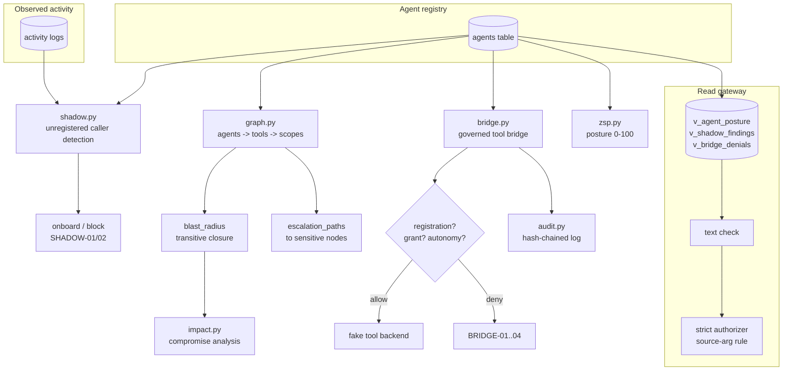

# Architecture

## Module responsibilities

| Module | Owns |
|---|---|
| `registry.py` | Agent inventory, autonomy levels L0-L3, status |
| `shadow.py` | Unregistered-caller detection + onboard/block scoring |
| `graph.py` | Privilege graph, blast radius, escalation paths |
| `impact.py` | Compromise exposure ranking + containment actions |
| `bridge.py` | Per-action governance (centerpiece) |
| `zsp.py` | Zero-standing-privilege posture score |
| `views.py` | Read-only views + SELECT-only gateway |
| `authz.py` | SQLite authorizer backstop (strict, view-aware) |
| `audit.py` | Hash-chained decision log |
| `feedback.py` | PII scrubbing before storage |

See also `docs/adr/0001-sqlite-authorizer-backstop.md` for the gateway
backstop decision.
